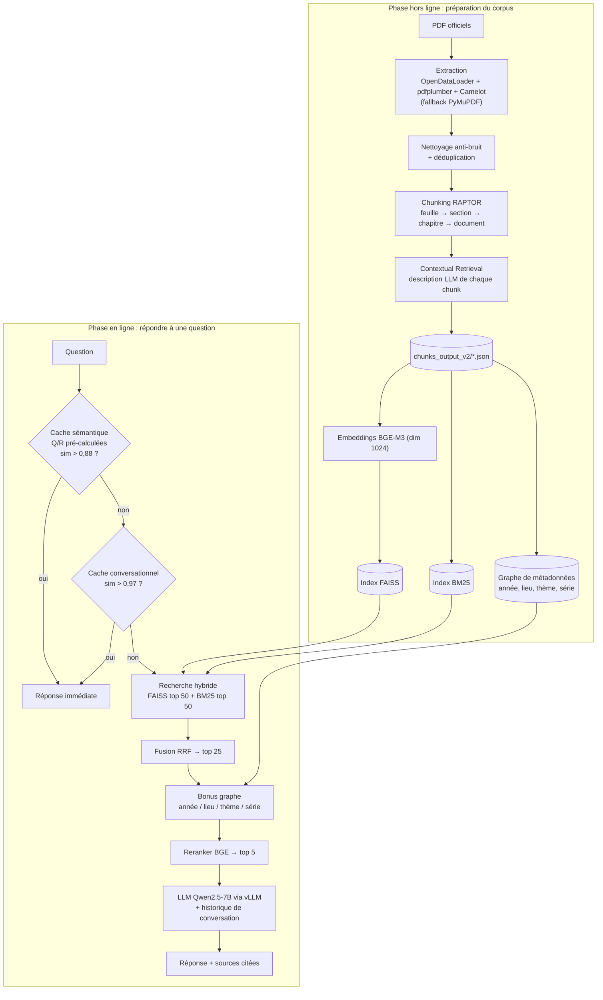

# ANSTAT-IA — Système RAG sur les statistiques officielles de Côte d'Ivoire

Assistant question-réponse fondé sur des **rapports statistiques officiels ivoiriens** (enquêtes sur le niveau de vie, démographie et santé, emploi, sécurité alimentaire, recensements, indices conjoncturels…).
Le système répond **uniquement à partir des documents** et cite ses sources (document, année, page).

> Projet réalisé dans le cadre d'un mémoire de Master.
> **Auteur :** Mahamoud Toib Kaba ([@Kaba2025](https://github.com/Kaba2025)) · **Établissement :** _à compléter_ · **Année :** 2026

---

## 1. Vue d'ensemble

Le projet suit une architecture **RAG (Retrieval-Augmented Generation)** en deux phases :

- **Hors ligne (une fois)** : lire les PDF, les découper en passages (« chunks »), les enrichir, puis les indexer.
- **En ligne (à chaque question)** : retrouver les passages les plus pertinents, puis demander à un LLM de rédiger une réponse sourcée.



Le détail de chaque étape, avec les paramètres réels et la justification des choix, est dans **[docs/PROCESSUS.md](docs/PROCESSUS.md)**.

## 2. Chiffres du corpus indexé

| Élément | Valeur |
|---|---|
| Fichiers de chunks (documents sources) | 46 |
| Chunks indexés au total | 15 164 |
| dont niveau « feuille » | 12 608 |
| dont niveau « section » | 2 035 |
| dont niveau « chapitre » | 490 |
| dont niveau « document » | 31 |
| Chunks issus de tableaux | 4 519 |
| Chunks avec contexte généré par LLM | 12 608 |
| Mots indexés | ≈ 3,47 millions |
| Années couvertes | 1985 → 2025 |
| Modèle d'embedding | `BAAI/bge-m3` (dim 1024) |
| Reranker | `BAAI/bge-reranker-v2-m3` |
| Générateur | `Qwen/Qwen2.5-7B-Instruct-AWQ` (via vLLM) |

_Source : `embeddings_v2/metadata.json` produit lors de l'indexation (mars 2026)._

## 3. Résultats d'évaluation (RAGAS)

Évaluation sur un échantillon de 1 000 questions, avec les métriques RAGAS.

| Métrique | RAG de base (13/04/2026) | RAG + fine-tuning (23/04/2026) |
|---|---|---|
| Faithfulness (fidélité) | 0,79 | 0,77 |
| Context precision | 0,72 | 0,81 |
| Context recall | 0,74 | 0,82 |
| Answer correctness | 0,75 | 0,79 |
| Answer relevancy | 0,76 | _non mesurée_ |
| **Score global pondéré** | **75,5 / 100** | **79,35 / 100** |

**Lecture prudente.** Les deux scores globaux ne sont pas strictement comparables : les pondérations diffèrent (35 % / 25 % / 20 % / 10 % / 10 % pour la version de base, 40 % / 30 % / 20 % / 10 % pour la version fine-tunée) et la métrique *answer relevancy* n'est présente que dans la première. Le gain vient surtout de la **recherche** (precision +0,09, recall +0,08), tandis que la fidélité reste stable (légère baisse de 0,02). Les rapports bruts sont dans [`results/`](results/).

## 4. Structure du dépôt

```
.
├── src/
│   ├── chunking.py                 # extraction PDF, nettoyage, chunking RAPTOR, contexte LLM
│   ├── build_cache_semantique.py   # index FAISS du cache de questions/réponses
│   ├── rag_system.py               # système RAG final (V3) : cache + recherche hybride + génération
│   ├── rag_system_v2.py            # version précédente (V2), conservée pour la comparaison
│   ├── evaluation_ragas.py         # génère le dataset d'évaluation en appelant le RAG, puis RAGAS
│   └── evaluation_finetuned.py     # évaluation RAGAS robuste (reprise sur checkpoint)
├── results/                        # rapports d'évaluation (JSON)
├── docs/
│   ├── PROCESSUS.md                # explication détaillée du pipeline
│   └── DONNEES.md                  # où héberger les données lourdes
├── data/                           # (vide) emplacement des données locales, ignoré par git
├── requirements.txt
├── .env.example
└── .gitignore
```

## 5. Installation

```bash
git clone https://github.com/Kaba2025/anstat-ia-rag.git
cd anstat-ia-rag
python -m venv .venv && source .venv/bin/activate    # Windows : .venv\Scripts\activate
pip install -r requirements.txt
cp .env.example .env                                  # puis adapte les valeurs
```

Variables de configuration (voir `.env.example`) :

| Variable | Rôle | Valeur par défaut |
|---|---|---|
| `VLLM_URL` | Endpoint chat du serveur vLLM | `http://localhost:8000/v1/chat/completions` |
| `VLLM_BASE_URL` | Base URL OpenAI-compatible (évaluation) | `http://localhost:8000/v1` |
| `EMBEDDING_MODEL_PATH` | Modèle d'embedding (nom Hugging Face ou chemin local) | `BAAI/bge-m3` |
| `RERANKER_MODEL_PATH` | Modèle de reranking | `BAAI/bge-reranker-v2-m3` |
| `DOCUMENTS_DIR` | Dossier contenant les PDF sources | `./documents` |

## 6. Utilisation

Le serveur vLLM doit tourner avant de lancer le chunking avec contexte LLM, le chat ou l'évaluation.

```bash
# 1. Chunking des PDF  (lit DOCUMENTS_DIR, écrit chunks_output_v2/)
python src/chunking.py

# 2. Index FAISS + BM25 + graphe  -> voir « À compléter » ci-dessous

# 3. Cache sémantique des questions/réponses
python src/build_cache_semantique.py

# 4. Poser des questions en terminal
python src/rag_system.py

# 5. Évaluer
python src/evaluation_ragas.py
```

## 7. Données non incluses dans le dépôt

Les index (≈ 500 Mo) et les rapports sources dépassent les limites raisonnables de GitHub (un fichier de plus de 100 Mo est refusé, et `cache_faiss.bin` fait ≈ 287 Mo). Ils sont exclus par `.gitignore`. Voir **[docs/DONNEES.md](docs/DONNEES.md)** pour les options d'hébergement (Hugging Face, Zenodo, Releases GitHub, Git LFS).

## 8. À compléter avant de publier

- [ ] Ajouter le script qui construit l'index (FAISS + BM25 + `graph_index.json`) à partir des chunks. Le code y fait référence sous le nom `embedding_v2.py`, mais ce fichier n'était pas dans l'archive fournie.
- [ ] Ajouter le script de fine-tuning du modèle (le dataset `finetune_dataset.jsonl` et le modèle `qwen_anstat_finetuned_q4km` sont cités dans l'évaluation, mais ne sont pas dans l'archive).
- [ ] Ajouter ou décrire `ragas_dataset.jsonl` (source de la première évaluation).
- [ ] Renseigner l'établissement et choisir une licence pour le code.
- [ ] Vérifier les conditions de réutilisation des rapports statistiques source avant de les redistribuer.
- [ ] Ajouter la référence du mémoire (lien ou DOI) en haut de ce fichier.

## 9. Limites connues

- Le système dépend d'un serveur vLLM local : sans lui, il bascule en mode « extraction » (passages bruts, sans rédaction).
- Le cache sémantique renvoie une réponse déjà connue si la similarité dépasse un seuil. Un seuil trop bas peut produire de faux positifs entre questions proches (par exemple « rural » contre « rural et urbain »).
- Le jeu de questions de l'évaluation (`finetune_dataset.jsonl`) est le même fichier que celui annoncé pour le fine-tuning et le cache. Si les questions évaluées ont servi à l'entraînement, les scores de la version fine-tunée sont optimistes : un jeu de test séparé est à prévoir ou à documenter.
- Le LLM juge de l'évaluation est un modèle 7B local, moins fiable qu'un grand modèle pour noter. Les scores sont à interpréter comme des ordres de grandeur.
- Le référentiel d'années, de lieux et de thèmes du graphe est écrit à la main dans `rag_system.py` : tout nouveau document hors de ce référentiel bénéficie moins du bonus de graphe.

## 10. Licence

_À choisir_ (par exemple MIT pour le code). Les documents sources appartiennent à leurs institutions productrices.
